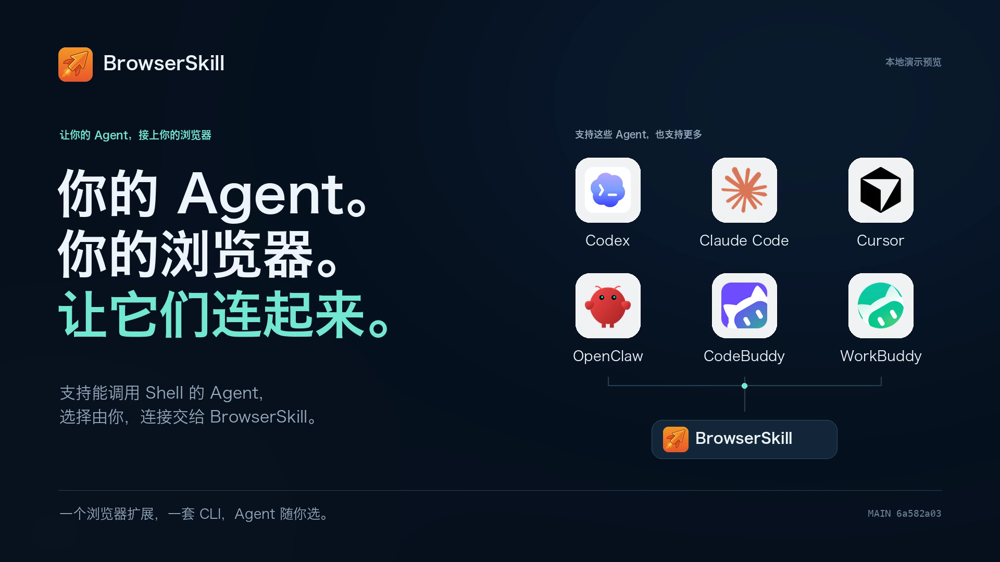

# Browser Agent

<p align="center">
  
</p>

<p align="center">
  <strong>你的 Agent。你的浏览器。连接，就能协作。</strong><br />
  让 AI Agent 在你熟悉、已登录的浏览器里办事。
</p>

<p align="center">
  <a href="https://github.com/browser-agent/"></a>
  <a href="#快速开始"></a>
</p>


<p align="center">
  <a href="README.md">English</a> · 中文<br />
  <a href="https://github.com/browser-agent/">官网</a> ·
  <a href="#看看实际效果">演示视频</a> ·
  <a href="#能做什么">功能一览</a> ·
  <a href="#网站调试">网站调试</a> ·
  <a href="#文档导航">文档导航</a> ·
  <a href="CHANGELOG.md">更新日志</a>
</p>

**Browser Agent 把你的 AI Agent 连接到 Chrome 或 Microsoft Edge，直接使用你已有的登录状态。** 交给它读取、点击、填表或排查问题。任务在独立、可见的 **Agent Window（代理窗口）** 中运行，需要时由你接手；也可以显式借用已有标签页，任务结束后归还。

## 看看实际效果

<details>
<summary><strong>â–¶ 观看演示 · 81 秒 · 中文版</strong><br /><picture></picture></summary>

https://github.com/user-attachments/assets/959cb520-80ba-4b9e-b6d8-d94523b03693

</details>

<p align="center">
  点击封面展开播放 · <a href="docs/assets/demo/demo-zh-CN.mp4">下载 MP4</a><br />
  基于 main 版本，在本地演示网站中录制的真实浏览器操作。
</p>

## 用你熟悉的 Agent

<table align="center">
  <tr>
    <td align="center" width="180"><br /><strong>Codex</strong></td>
    <td align="center" width="180"><br /><strong>Claude Code</strong></td>
    <td align="center" width="180"><br /><strong>Cursor</strong></td>
    <td align="center" width="180"><br /><strong>OpenClaw</strong></td>
  </tr>
  <tr>
    <td align="center" width="180"><br /><strong>CodeBuddy</strong></td>
    <td align="center" width="180"><br /><strong>WorkBuddy</strong></td>
    <td align="center" width="180"><br /><strong>Pi</strong></td>
    <td align="center" width="180"><br /><strong>Hermes Agent</strong></td>
  </tr>
</table>

Qoder、Qoder CN 与 DeepSeek Harness 同样作为 skill 安装目标支持（`bsk install-skill --harness qoder`、`--harness qoder-cn` 和 `--harness dsh`）。

这些 Agent，以及其他能调用 Shell 的 Agent，都可以通过同一套 **`bsk` CLI** 使用；支持 MCP 的客户端也可通过 **`bsk mcp`** 接入（[MCP 配置](docs/mcp.md)）。Agent 和模型由你选择，Browser Agent 负责连接浏览器。

## 能做什么

| 你想完成的事 | Browser Agent 如何帮忙 |
| --- | --- |
| **用已有账号，做网站任务** | 复用浏览器登录态，读取文档、搜索内部网站，完成需要登录的网页流程。 |
| **一句指令，落实到操作** | 读取页面文本和控件，点击、输入、填写表单、拖拽元素、选择范围、管理标签页；截取可见区域或完整页面，在本地模式上传和下载文件。 |
| **Agent 操作，你来掌控** | 共享控制让你与 Agent 协作；编辑时暂停 Agent，让它核对你的改动后继续。任务在独立窗口中可见运行，也可显式借用已有标签页。 |
| **网页表格，导出即用** | 将已加载的表格和列表导出为 JSON/CSV，保留列名、页面/frame 来源、合并单元格信息和完整性标记。[结构化提取](docs/structured-extraction.md) |
| **操作出错，找到线索** | 关联操作、请求、响应正文、控制台和页面变化，检查性能、慢接口与疑似重复请求；用明确配置的 HTTP 规则或请求重放验证判断。[网站调试](docs/website-debugging.md) |
| **录下过程，随时回看** | 将一个已授权的任务标签页录制为无声 MP4，在扩展中预览、保存或删除。[任务视频录制](docs/video-recording.md) |
| **页面就绪，再做下一步** | 设置明确的超时，等待目标元素满足指定条件后再继续操作。[元素等待](docs/wait-for-element.md) |
| **已经观察，按需复用** | 用 `step` 执行一个已决定的动作并同步状态；明确保存完整观察结果，再用 `view` 搜索或分段阅读，无需重新采集页面。[步骤与观察结果保存](crates/bsk-cli/skill/references/step-and-cache.md) |
| **浏览器与账号，选对再开工** | 为浏览器实例命名，让任务绑定指定 Profile；也可以让服务器上的 Agent 连接你电脑上的浏览器。[浏览器 Profile](docs/browser-profiles.md) |
| **任务结束，记录可查** | 重新打开浏览器本地的调试历史、导出 JSON，或单独开启操作审计，查看任务执行记录。[操作审计](docs/operation-audit.md) |

## 快速开始

本地自动化需要 **AI Agent + `bsk` CLI + 浏览器扩展**。CLI 自带后台守护进程（daemon），skill 则负责告诉 Agent 如何使用这些工具。

| 组件 | 支持环境 |
| --- | --- |
| CLI / daemon | macOS：Apple Silicon、Intel；Linux：x64、ARM64；Windows：x64 |
| 浏览器扩展 | 基于 Chromium 125 或更新版本的 Chrome、Microsoft Edge。其他 Chromium 浏览器可能可用，但不保证兼容。 |
| Agent 接入 | 能调用 Shell 或支持 MCP 的 Agent 配合 Browser Agent skill（[MCP 配置](docs/mcp.md)）。 |

### 让 Agent 帮你安装

把下面这句话发给 Agent：

```text
按照 https://raw.githubusercontent.com//Browser Agent/main/AGENT_INSTALL.md 的说明，在本机安装并配置 browser-agent。
```

安装指南会引导 Agent 安装 CLI、安装对应的 skill、检查连接，并完成第一次浏览器任务。你仍需在想使用的浏览器中安装扩展：

**[安装 Chrome 扩展](https://chromewebstore.google.com/detail/hhcmgoofomhgciiibhipgmgkgnoenaoi)** · **[安装 Edge 扩展](https://microsoftedge.microsoft.com/addons/detail/Browser Agent/emacgiaaaiojkkpkddmmdfhmokgmnikg)**

<details>
<summary><b>手动安装步骤</b></summary>

#### 1. 安装 CLI

macOS / Linux：

```sh
curl -fsSL https://raw.githubusercontent.com//Browser Agent/main/install.sh | sh
export PATH="${BSK_INSTALL_DIR:-$HOME/.local/bin}:$PATH"
```

Windows PowerShell：

```powershell
irm https://raw.githubusercontent.com//Browser Agent/main/install.ps1 | iex
```

默认安装到 `~/.local/bin`。在实际使用工具的终端或 Agent 环境中检查：

```sh
bsk --version
```

如果已启动的 Agent 找不到 `bsk`，重启 Agent 以加载新的 PATH，或配置安装后二进制的绝对路径。

#### 2. 连接扩展

从 [Chrome Web Store](https://chromewebstore.google.com/detail/hhcmgoofomhgciiibhipgmgkgnoenaoi) 或 [Edge 加载项商店](https://microsoftedge.microsoft.com/addons/detail/Browser Agent/emacgiaaaiojkkpkddmmdfhmokgmnikg) 安装扩展，开启连接后即可使用。本机配对是可选的：未配对仍可正常使用，扩展会提示连接身份未经验证。如需配对，运行 `bsk daemon pair`，将链接粘贴到**连接设置 → 配对链接**并保存。重启和升级后无需重复配对；已配对后验证失败不会自动跳过验证。详见[本机配对指南](docs/local-pairing.zh-CN.md)。

#### 3. 给 Agent 安装 skill

```sh
bsk install-skill
```

按 **空格** 选择使用的 Agent，按 **Enter** 安装。非交互安装时显式指定目标，例如：

```sh
bsk install-skill --harness cursor --json
```

用 `bsk install-skill --list` 查看支持的目标和安装路径。已有安装默认跳过，只有显式使用 `--force` 才会覆盖。其他 Agent 可将完整的 [`crates/bsk-cli/skill/`](crates/bsk-cli/skill/) 目录复制到其 skill 目录下，命名为 `browser-agent/`，保留其中的 `references/`。

支持 MCP 的客户端还可以通过 `bsk install-skill --harness codex --mcp` 一并配置本地 stdio 服务（同样支持 `claude-code` 和 `cursor`），详见 [MCP 配置与工作流](docs/mcp.md)。

#### 4. 验证连接

```sh
bsk doctor
```

解决失败项，确认扩展显示**已连接**。再开启一个新的 Agent 会话，确认能发现 `browser-agent`；doctor 通过并不代表 Agent 已加载 skill。

</details>

### 试一个任务

连接成功后，对 Agent 说：

```text
使用 browser-agent 打开 https://example.com，总结页面内容，完成后结束浏览器会话。
```

Agent 默认在后台打开独立代理窗口、读取页面、返回总结，并结束任务。误入代理窗口的外部链接或手动新建标签会移回最近使用的普通用户窗口；没有用户窗口时会新建一个。分流发生在标签创建之后，可能短暂显示在代理窗口中。页面打开的子标签、人类协助和录制流程会保留。支持 skill 斜杠命令的 Agent，也可以通过 `/browser-agent` 调用。

将任一受控标签移出原代理窗口会结束整个浏览器会话，保留全部页面并清除控制标识；借用页也留在当前位置。拖回标签不会恢复任务，需要由用户决定是否重新开始。同窗口内调整标签顺序不受影响，正常结束会话仍按原规则归还借用页、清理任务页。

网页打开原生弹窗时，Chrome 仍可能激活窗口。对于观察到的任务弹窗，若用户没有切换窗口，扩展会恢复之前的 Chrome 用户窗口或最小化状态。Chrome 公开扩展 API 无法保证完全没有瞬时激活，也无法恢复其他应用的焦点。

<details>
<summary><b>直接试用 CLI</b></summary>

先创建会话，记下返回的 `session_id`：

```sh
bsk session start --json
```

将下面每条命令中的 `<id>` 替换为该值。有多个浏览器连接时，在创建会话时用 `--browser <实例 ID 或名称>` 选择目标。默认后台创建，仍兼容 `--no-focus`；显式使用 `--focus` 可将新窗口置于前台。请求人类帮助和交互录制仍会将相关窗口置于前台。

```sh
bsk navigate https://example.com --session <id>
bsk observe --session <id>
bsk screenshot --session <id> --out example.png
bsk session stop <id>
```

通过 `bsk --help` 或 `bsk <命令> --help` 查看参数。完成或失败后都应结束会话；借用的标签页会归还到原窗口。

</details>

在 WorkBuddy/CodeBuddy 或会回收命令子进程的宿主中，Agent 应先复用已有 daemon；需要启动时，在宿主管理的后台任务中运行 `bsk daemon start --foreground`，并在另一条工具调用中验证连接。[宿主配置指南](docs/sandboxed-agents.md)说明了如何共用 `BSK_HOME`、设置 `BSK_AUTO_START=0`，以及宿主无法维持任务时的独立终端兜底方式。

### 关闭闲置的代理窗口

任务完成后，可以让 Agent 结束浏览器会话。如果任务中断后代理窗口仍然开着，请在同一个 daemon 上查看会话列表：

```sh
bsk session list
bsk session stop SESSION_ID
```

根据 `BROWSER`、`AGENT WINDOW` 和 `CONTROLLER / PROJECT` 列找到闲置的任务，将 `SESSION_ID` 替换为 `SESSION` 列的值。清理成功后，Browser Agent 会归还借用的标签页，并在窗口中没有剩余用户标签页时关闭任务窗口。如果希望保存正在录制的操作记录，请使用 `bsk record stop`。

如果窗口不在列表中，先确认使用的是任务当时的 `BSK_HOME`。如果窗口已经不属于任何会话，可以保存其中的工作后，在浏览器中手动关闭。

## DeepSeek Harness 插件

将 `web` 替换为自己的 profile 名称。

## 网站调试

**让 Agent 看到问题发生时的浏览器证据。** 在你有权调试的网站上，先开启采集，再复现问题，随后在扩展中查看，或交给 Agent 分析。

- **沿着操作找原因**：查看一次操作关联的请求、控制台输出、表单字段值，以及即时或延后的页面变化；既记录 Agent 操作，也记录受支持的手动操作。
- **展开请求看细节**：读取已保留的请求头、提交数据、响应正文、耗时与错误，筛选流量或直接查看某个 JSON 字段。
- **检查性能和接口**：查看页面加载指标、接口耗时统计和疑似重复请求；缺失或不完整的数据会明确标记。
- **验证并保留证据**：配置任务内的请求修改、拦截、模拟响应或同源请求重放，导出 JSON，供后续复查和分享。

例如可以这样交代任务：

```text
使用 browser-agent 排查 http://localhost:3000 的表单保存失败问题。复现前开启网站调试，检查请求、响应和控制台，最后导出调试证据并结束会话。
```

也可以在扩展中打开**快捷功能 → 网站调试**，对已有任务启动采集。调试页将操作时间线、请求、控制台、页面状态、性能和 API 分析放在一起。任务结束后，即使没有连接 daemon，仍可打开历史查看记录；新的 Agent 任务需要你提供导出的文件，才能分析已结束任务的历史。

请求重放会使用页面当前会话发送一次新请求，可能改变服务端数据。采集和脱敏均有限制，保存的证据仍可能包含敏感信息。完整流程、CLI 示例及限制见[网站调试指南](docs/website-debugging.md)。

## 更多用法

### 截取完整页面

打开**快捷功能 → 长截图**，选择自动滚动、手动滚动拼接长图或截取可见区域。这个扩展功能无需连接 Agent 或 daemon，也可以独立使用。

对 Agent 会话中的页面，可以执行：

```sh
bsk screenshot --session <id> --full-page --out page.png
```

Agent 截图支持后台标签页，无需将窗口切到前台；原文档仍可访问时，完成后会恢复滚动位置。长截图沿页面文档滚动，嵌套滚动面板和虚拟列表存在支持限制。详见[长截图指南](docs/long-screenshot.md)。

### 使用指定浏览器 Profile

在目标 Profile 的扩展弹窗中点击**复制此 Profile 的指令**，将指令和任务一起发给 Agent。也可以设置唯一的**浏览器名称**，再显式选择：

```sh
bsk browsers
bsk session start --browser "工作账号" --no-focus --json
```

这个名称由你在 Browser Agent 中设置，不会自动读取 Chrome 的 Profile 名称。每个会话固定使用选定的实例。详见[Profile 选择指南](docs/browser-profiles.md)。

### Agent 在服务器，浏览器在本机

保留本机浏览器和登录态，让 Agent、CLI 与 daemon 在服务器运行。扩展通过经过鉴权的 WSS 与服务器配对，由浏览器主动建立连接，本机无需开放入站端口。

内置服务端支持设备配对、续期和撤销授权。`bsk upload` 和 `bsk download` 文件传输命令仍仅支持本地模式。经过授权的视频导出可以写入 CLI 所在计算机，包括远程服务器；扩展中的“另存为 MP4”写入浏览器所在计算机。详见[远程连接指南](docs/remote-extension-connection.md)。

## 浏览器控制与隐私

新任务默认启用共享控制。Browser Agent 会观察受控标签页中的页面变化和受支持的手动活动，让 Agent 在你编辑时让出控制权，并在再次操作前同步状态。即使调试、审计和视频录制均关闭，这种协调仍会进行。你可以通过任务的手动接管与恢复功能决定何时继续。[共享控制指南](crates/bsk-cli/skill/references/cooperation.md)

代理窗口共享所选 Profile 的登录态，**它不是独立账号，也不是安全沙盒**。Agent 可以使用已登录网站授予的权限执行操作，请选择你信任的 Agent 和任务。

扩展提供两个默认开启、相互独立的**自动化设置**：

| 设置 | 控制什么 |
| --- | --- |
| **借用标签页前确认** | Agent 接管你已有的标签页之前，先请求确认。关闭后允许免确认借用。 |
| **允许请求人工协助** | 允许 Agent 请你处理登录、验证或其他需要本人参与的步骤。 |

浏览器中保存的设置对已有和新建会话生效。旧的 `--unattended`、`tab borrow --no-confirm`、`BSK_REQUEST_HELP=off` 不能覆盖这些设置。关闭人工协助不代表待处理步骤已经完成。关闭代理窗口可以停止其中的任务。

Browser Agent 没有必须使用的云服务，也不收集产品遥测。自动化结果交给你选定的 daemon 或网关，以及使用它的 Agent；对应 Agent 或服务可能按自身政策处理或保留数据。扩展不会自行调用 AI 提供商。

| 可选历史与视频记录 | 保存位置 | 需要知道的事 |
| --- | --- | --- |
| **网站调试** | 当前浏览器配置中，远程模式也一样 | 保存采集到的数据，包括可获取的正文和字段值。已停止记录 30 天后过期，保留预算为 50 条／50 MiB，达到限制时可能提前清理。删除记录前需先停止采集。 |
| **操作审计** | daemon 所在主机的 `BSK_HOME/audit` | 默认关闭。记录任务与操作元数据，不记录输入值、页面正文、截图或文件内容。已结束任务 30 天后过期。 |
| **任务视频** | 当前浏览器配置；导出副本保存在指定位置 | 主动开启后，录制一个已授权标签页的无声视频；单个视频上限为 10 分钟／256 MiB，创建 24 小时后过期，临时视频预算为 1 GiB。视频库支持预览、导出和删除。 |
| **观察结果及 step 响应** | CLI 所在计算机上明确指定的 JSON 路径，也可能是远程服务器 | `--save-full` 会在显示过滤前保存完整响应。文件不会自动过期，需要在该计算机上删除；`view` 读取历史数据，不会刷新浏览器状态。 |

这些功能均支持导出和删除。结束任务或断开连接不会删除保留的历史或视频，过期数据会在访问或清理时处理。导出的文件、Agent 或网关已经收到的副本需要另行管理。调试数据会过滤已知敏感信息，但不能保证完全脱敏。视频画面不会自动脱敏，分享前请检查可见内容。

[隐私政策](apps/extension/PRIVACY.zh-CN.md) · [操作审计](docs/operation-audit.md) · [调试历史与保留限制](docs/website-debugging.md#history-and-export)

## 升级

**升级到 0.4.1 时，先更新 CLI 并重启正在运行的 daemon，再更新扩展。** CLI/daemon 和扩展 0.4.1 使用协议 1.8，新的默认 target 策略要求两端均支持 1.8。仅替换二进制不会更新通过前台或外部进程管理器运行的旧 daemon，仍需在所属宿主中重启。使用新流程时请配套使用 0.4.1 组件。

已有脚本需要遵循[共享控制流程](crates/bsk-cli/skill/references/cooperation.md)：首次导航后执行 `bsk cooperate sync`，将返回的 `context_id` 作为 `--context` 传入。target 策略下，DOM 操作和补充观察可以复用该控制上下文，决策依赖的业务事实用 `--expect` 显式校验。脚本、无目标按键和视觉操作还需将同步返回的 `observation_id` 作为 `--observation` 传入。人工介入或导航后重新同步；若要保留每个上下文只执行一次操作的流程，在首次同步时指定 `--policy strict`。继续任务前请加载新版 skill。

先结束正在执行的浏览器任务，再更新 CLI：

```sh
bsk update --yes
```

手动更新和 daemon 自动更新默认优先从官网国内下载源获取清单与安装包；下载、清单解析、校验或解压失败时回退 GitHub。GitHub 安装包固定为已选版本，并使用同一 SHA256 校验值。两个源都失败时，错误会列出各自的 URL 和失败原因。显式设置 `BSK_UPDATE_MANIFEST_URL` 后，仅使用自定义清单及其中的安装包地址，不启用内置公共源回退。

默认本地配置下，这条命令会在 daemon 继续服务的同时安装新版本并检查它能否运行，然后用新版本在原端口重启 daemon。重启后的 daemon 没有就绪时，会放回旧版本并用它重启 daemon。通过 `--foreground` 启动的 daemon 不会被停止，会继续运行旧版本，请在它所在的终端或进程管理器中重启。如果 `bsk update` 运行在无法重新启动后台 daemon 的环境里（例如 Windows Job 禁止 breakaway 的沙盒），后台 daemon 同样不会被停止，请在沙盒外执行 `bsk daemon restart`。如果使用安装脚本替换了二进制，请随后执行 `bsk daemon restart`。

由 `bsk` 在后台启动的 daemon 还会每 30 分钟检查一次新版本。没有 Agent 会话时，它按同样方式安装新版本，再用新版本启动一个 daemon，确认新版本的 daemon 已在原端口服务后才退出。新 daemon 退出，或 20 秒内没有就绪时，它会被停止，当前 daemon 放回旧版本，在原端口继续服务，6 小时后再尝试这个版本。交接期间浏览器连接会短暂断开并自动重连。更新过程中 daemon 因其他原因（例如空闲超时）停止时，会先放回旧版本再退出。通过 `--foreground` 启动的 daemon 归所在终端或进程管理器管理，只提示新版本：执行 `bsk update`，再在那里重启 daemon。bsk 无法在可执行文件所在目录写入时，也只提示新版本，请用原来的安装脚本或包管理器升级。设置 `BSK_AUTO_UPDATE=off` 可关闭 daemon 自动升级，手动 `bsk update` 仍然可用。

`bsk doctor` 会显示最近一次更新的结果；bsk home 下的 `update-state.json` 记录了它的阶段、结果和错误原因。同一个可执行文件的更新会依次进行，即使来自不同的 bsk home 也是如此，靠的是它旁边的 `.bsk.update.lock`（Windows 上为 `.bsk.exe.update.lock`），这个文件会一直保留。更新确认成功前，旧版本会以 `.bsk.old-*`（Windows 上为 `.bsk.exe.old-*`）的名字留在新版本旁边；仍在运行的旧版本会保留到对应进程退出，之后再启动 daemon 时会清理。Windows 上的自更新依赖重命名正在运行的可执行文件，NTFS 支持这一操作；文件系统不支持时，更新会失败，已安装的版本保持不变。bsk 支持 Windows 10 和 Windows Server 2016 及以上版本。

扩展通过浏览器商店更新。通过 `bsk --version`、`bsk status` 和 `bsk doctor` 检查版本与连接。使用新功能时，保持 CLI、正在运行的 daemon、扩展版本匹配。本 README 介绍当前仓库的能力，商店版本可能因审核而滞后；已发布内容以[更新日志](CHANGELOG.md)和 [Releases](https://github.com/Browser Agent/releases) 为准。

受管理的 CLI skill 在文件未被修改时，会随 daemon 启动、`session start` 或 `doctor` 自动同步；本地修改和自定义 skill 会保留。开启新的 Agent 会话以加载更新后的指令，doctor 会提示暂停同步的安装。

<details>
<summary><b>自定义端口、沙盒宿主和远程服务器</b></summary>

在 daemon 所属宿主或进程管理器中停止服务，执行 `bsk update --yes --no-restart-daemon`，再使用原参数与 `BSK_HOME` 启动。管理期间，在 Agent 命令中设置 `BSK_AUTO_START=0`。具体步骤见[沙盒](docs/sandboxed-agents.md)或[远程连接](docs/remote-extension-connection.md)指南。

</details>

## 文档导航

| 你想做什么 | 文档 |
| --- | --- |
| 让 Agent 安装并验证连接 | [安装指南](AGENT_INSTALL.md) |
| 排查网站或接口问题 | [网站调试](docs/website-debugging.md) |
| 截取长页面 | [长截图](docs/long-screenshot.md) |
| 录制并保存任务视频 | [任务视频录制](docs/video-recording.md) |
| 导出表格或列表 | [结构化提取](docs/structured-extraction.md) |
| 等待元素条件 | [元素等待](docs/wait-for-element.md) |
| 一次执行多个已决定的动作 | [Plan 命令](docs/plan.md) |
| 保存并回放已审阅的流程 | [Recipe 命令](docs/recipes.md) |
| 使用指定账号或 Profile | [浏览器 Profile](docs/browser-profiles.md) |
| 连接服务器上的 Agent | [远程浏览器连接](docs/remote-extension-connection.md) |
| 在沙盒中使用 | [沙盒环境配置](docs/sandboxed-agents.md) |
| 回看任务操作元数据 | [操作审计](docs/operation-audit.md) |
| 通过 MCP 接入 | [MCP 服务](docs/mcp.md) |
| 了解项目实现 | [架构](docs/architecture.md) · [协议](crates/bsk-protocol/README.md) |

## 面向开发者

项目使用 Rust + pnpm workspace。源码构建需要 Rust stable、Node.js 22，以及 `package.json` 声明的 pnpm 版本：

```sh
pnpm install --frozen-lockfile
cargo build --release --locked
pnpm ext:build
```

CLI 产物位于 `target/release/`；将 `apps/extension/dist/chrome-mv3/` 作为解压后的扩展加载。开发扩展时使用 `pnpm ext:dev`。

| 目录 | 内容 |
| --- | --- |
| `crates/bsk-cli` | CLI、daemon 和内置 Agent skill |
| `crates/bsk-protocol` | 通信类型与 JSON Schema |
| `apps/extension` | 浏览器自动化、调试工作区和扩展界面 |
| `packages/ui`、`packages/i18n`、`packages/vom` | 共享 UI、多语言和页面观察 |
| `evals/browser` | 本地测试页面与浏览器能力评测 |

相关检查包括 `cargo test --workspace --locked`、`pnpm ext:test` 和 `pnpm lint`。可复现的浏览器用例见[评测指南](evals/browser/README.zh-CN.md)。欢迎通过 [GitHub Issues](https://github.com/Browser Agent/issues) 报告问题，或提交聚焦的 PR；附上浏览器证据前，请移除敏感数据。

对浏览器交互、页面观察、控制策略或 CLI／扩展通信等较大改动，推荐在提交 PR 前使用[可选的 Agent 端到端自测 Skill](evals/browser/README.zh-CN.md#可选的-agent-pr-前自测)，通过 Bsk 测试当前分支并记录真实链路证据。这不是提交或合并 PR 的强制要求，也不替代上述检查。

扩展界面支持英语、简体中文、繁体中文、韩语、日语、法语、意大利语、西班牙语、德语和巴西葡萄牙语。翻译贡献见[多语言说明](packages/i18n/README.md)。

## 贡献者

感谢每一位贡献代码、文档、翻译与反馈的朋友。

<!-- CONTRIBUTORS:START -->
<!-- Generated by node scripts/update-readme-contributors.mjs -->
<p align="center">
  <a href="https://github.com/Xiaowei"></a>
  <a href="https://github.com/iuyo5678"></a>
  <a href="https://github.com/Ljy-0827"></a>
  <a href="https://github.com/BB-fat"></a>
  <a href="https://github.com/NianJiuZst"></a>
  <a href="https://github.com/shnpd"></a>
  <a href="https://github.com/lyingbug"></a>
  <a href="https://github.com/ch-z-hc"></a>
  <a href="https://github.com/kevin9327"></a>
  <a href="https://github.com/ArcueidMP"></a>
  <br />
  <a href="https://github.com/MaxFreedomPollard"></a>
  <a href="https://github.com/legend91019"></a>
  <a href="https://github.com/wcy12378"></a>
  <a href="https://github.com/iAstro"></a>
  <a href="https://github.com/lymerin"></a>
  <a href="https://github.com/hobostay"></a>
  <a href="https://github.com/martinm86867-ops"></a>
  <a href="https://github.com/starsstreaming"></a>
  <a href="https://github.com/xiyanjun"></a>
  <a href="https://github.com/klren0312"></a>
  <br />
  <a href="https://github.com/hZsFN"></a>
  <a href="https://github.com/cyberspace-cs"></a>
  <a href="https://github.com/basil-k-aji-dev"></a>
  <a href="https://github.com/PerryLink"></a>
  <a href="https://github.com/Li-john1021"></a>
  <a href="https://github.com/dayi"></a>
  <a href="https://github.com/zhuhaoran291"></a>
  <a href="https://github.com/u7-u7"></a>
  <a href="https://github.com/huong8373tt-beep"></a>
  <a href="https://github.com/hjxccc"></a>
  <br />
  <a href="https://github.com/zjxzjw"></a>
  <a href="https://github.com/dvd233"></a>
  <a href="https://github.com/drakeo338"></a>
  <a href="https://github.com/dr-coton"></a>
  <a href="https://github.com/djtzemx"></a>
  <a href="https://github.com/WhyBusyy"></a>
  <a href="https://github.com/Sthreal"></a>
  <a href="https://github.com/KennyMcSimpson"></a>
  <a href="https://github.com/MakerFlyFly"></a>
  <a href="https://github.com/claude"></a>
</p>
<!-- CONTRIBUTORS:END -->

<p align="center">
  <a href="https://github.com/Browser Agent/graphs/contributors">查看 GitHub 贡献记录</a> ·
  <a href="https://github.com/Browser Agent/issues">提交问题与建议</a>
</p>

### 动态页面读取（未发布，协议 1.9）

持续动画中的 DOM 字段使用 `bsk read`，表格/列表使用 `extract`；MCP 对应
`bsk_inspect(action=read)`。脚本只声明 `--expect` 事实时只校验这些事实，传入 `--observation` 时仍比对整页，
`evaluate --unverified` 是最后手段；读取结果不会更新操作凭证，
业务判断须用 expect 保护。查询格式、安全边界、兼容性和可复现浏览器测试见
[动态页面读取说明](docs/dynamic-reading.md)。


